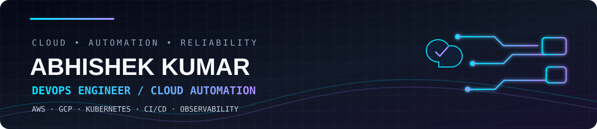
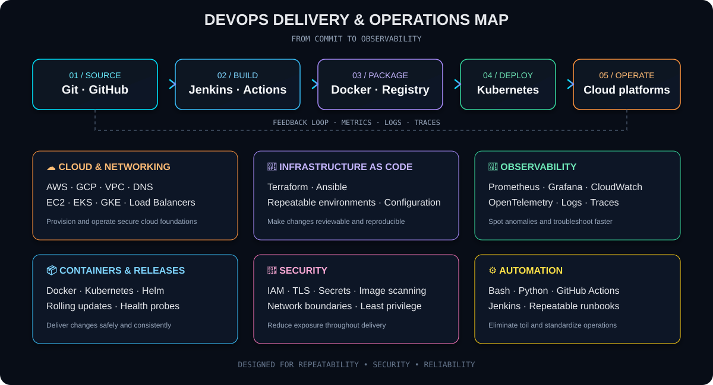

<div align="center">



<br/>

[](https://git.io/typing-svg)

<p>
  <a href="https://github.com/abhuu123?tab=repositories"></a>
  <a href="https://www.linkedin.com/in/abhishek-kumar-18b929376"></a>
  <a href="mailto:abhi431921@gmail.com"></a>
</p>


</div>

---

## ⚡ `whoami` — The operator behind the automation

```yaml
name: Abhishek Kumar
role: DevOps Engineer
cloud: [AWS, GCP]
focus:
  - Kubernetes and container platforms
  - CI/CD automation and safe releases
  - Infrastructure as Code
  - Monitoring, observability, and reliability
  - Cloud security and cost optimization
```

I’m a **DevOps Engineer with 1+ year of production experience** working across cloud infrastructure, containerized applications, delivery automation, and production troubleshooting. I like turning repetitive operations into reliable workflows and making systems easier to deploy, monitor, and maintain.

<table>
  <tr>
    <td width="50%">
      <h3>🚀 BUILD & SHIP</h3>
      <sub>Docker · Kubernetes · Jenkins · GitHub Actions · Argo CD</sub>
    </td>
    <td width="50%">
      <h3>☁️ CLOUD & INFRA</h3>
      <sub>AWS · GCP · Terraform · Ansible · Linux</sub>
    </td>
  </tr>
  <tr>
    <td width="50%">
      <h3>📡 OBSERVE & IMPROVE</h3>
      <sub>Prometheus · Grafana · OpenTelemetry · CloudWatch</sub>
    </td>
    <td width="50%">
      <h3>🔐 SECURE & RELIABLY OPERATE</h3>
      <sub>IAM · TLS · Nginx · DNS · Incident response</sub>
    </td>
  </tr>
</table>

---

## 🧩 Live tech stack

<p align="center">
  <strong>Cloud & Platforms</strong><br/>
  <a href="https://skillicons.dev"></a>
</p>
<p align="center">
  <strong>Containers · CI/CD · Infrastructure as Code</strong><br/>
  <a href="https://skillicons.dev"></a>
</p>
<p align="center">
  <strong>Monitoring · Scripting · Operating Systems</strong><br/>
  <a href="https://skillicons.dev"></a>
</p>

<p align="center"><sub>These icons are served by Skill Icons, so the icon row updates from the service rather than being manually drawn into the README.</sub></p>

---

## 🏗️ DevOps architecture lab

<p align="center">
  
</p>

<details>
<summary><strong>🔎 How the pieces connect</strong></summary>

- **Source:** Git and GitHub host code and pipeline definitions.
- **Build & verify:** Jenkins or GitHub Actions build, test, and scan application images.
- **Package & deploy:** Docker images are published to a registry and rolled out to Kubernetes.
- **Provision:** Terraform manages cloud infrastructure; Ansible can configure hosts.
- **Observe:** Prometheus, Grafana, CloudWatch, and OpenTelemetry help monitor health and trace issues.
- **Protect:** IAM, secrets handling, TLS, network boundaries, and image scanning help reduce risk.

</details>

---

## 🛠️ Featured projects

<table>
  <tr>
    <td width="50%" valign="top">
      <h3>🐳 Dockerized CRUD App</h3>
      <p>Three-tier application using React, Node.js, PostgreSQL, and Docker Compose.</p>
      <a href="https://github.com/abhuu123/crud-app">↗ Open repository</a>
    </td>
    <td width="50%" valign="top">
      <h3>🔁 CI/CD Pipeline</h3>
      <p>Multi-container delivery project focused on automated builds, tests, and deployments.</p>
      <a href="https://github.com/abhuu123/CI-CD-PIPELINE">↗ Open repository</a>
    </td>
  </tr>
  <tr>
    <td width="50%" valign="top">
      <h3>📊 Docker Observability</h3>
      <p>Prometheus, Grafana, and cAdvisor for container metrics and monitoring.</p>
      <a href="https://github.com/abhuu123/grafana-prometheus-cAdvisor-for-docker">↗ Open repository</a>
    </td>
    <td width="50%" valign="top">
      <h3>☸️ Kubernetes Application</h3>
      <p>Frontend, backend, and PostgreSQL deployed using Kubernetes YAML manifests.</p>
      <a href="https://github.com/abhuu123/kubernetes-app">↗ Open repository</a>
    </td>
  </tr>
  <tr>
    <td width="50%" valign="top">
      <h3>🎬 Netflix Clone on Docker</h3>
      <p>Containerized web application deployed on an AWS EC2 instance.</p>
      <a href="https://github.com/abhuu123/netflix-on-docker">↗ Open repository</a>
    </td>
    <td width="50%" valign="top">
      <h3>🧭 More cloud & automation work</h3>
      <p>Explore the rest of my infrastructure, scripting, and deployment repositories.</p>
      <a href="https://github.com/abhuu123?tab=repositories">↗ All repositories</a>
    </td>
  </tr>
</table>

---

## 📊 GitHub dashboard

<p align="center">
  
  
</p>

<p align="center">
  
</p>

---

## 🤝 Let's connect

<p align="center">
  <a href="https://github.com/abhuu123"></a>
  <a href="https://www.linkedin.com/in/abhishek-kumar-18b929376"></a>
  <a href="mailto:abhi431921@gmail.com"></a>
</p>

<p align="center"><strong>Build thoughtfully. Automate relentlessly. Keep production healthy.</strong></p>
